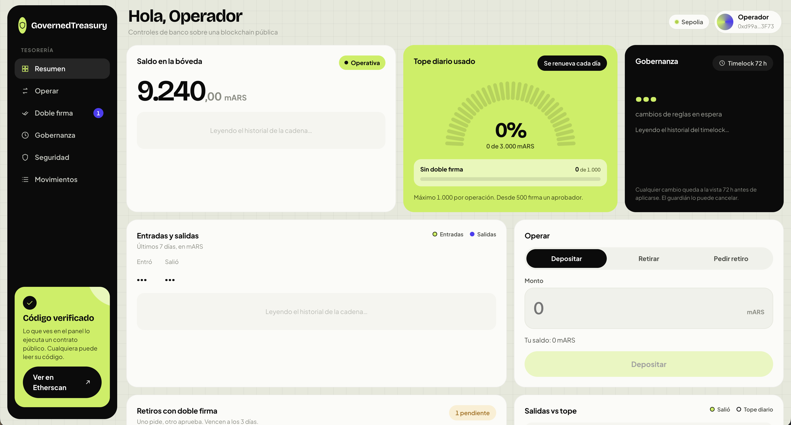
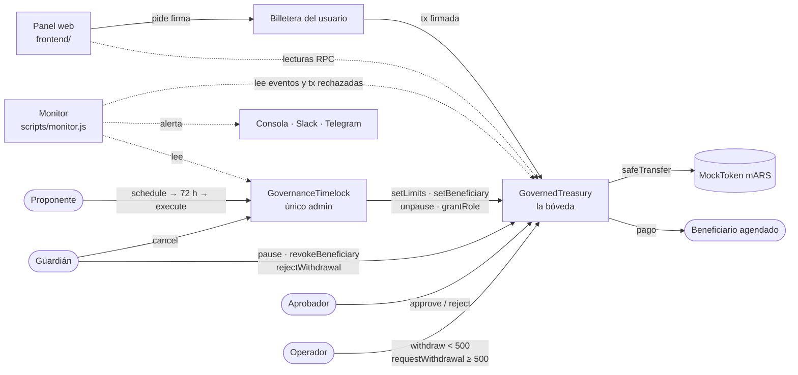

# GovernedTreasury

**Proyecto final del Ethereum Developer Pack (ETH Kipu · Talento Tech). Autor: Jerónimo Núñez.**

[](https://github.com/jeronimoenunez/governed-treasury/actions/workflows/ci.yml)

Tesorería on-chain de tokens ERC-20 simulando los controles internos que tiene cualquier banco: quien pide un pago no es quien lo aprueba, los montos grandes llevan doble firma, hay topes por operación y por día, solo se paga a destinos agendados y cualquier cambio de reglas espera 72 horas a la vista de todos. El problema que resuelve es el de los contratos con `onlyOwner`: ahí una sola clave puede vaciar la bóveda o cambiar las reglas en una transacción, sin segunda firma, sin espera y sin que nadie pueda frenarla. Si roban esa clave, se pierde todo. Acá no existe esa clave: ninguna cuenta sola puede vaciar la bóveda ni ampliar las reglas al instante. Ampliar permisos espera 72 h a la vista y en ese lapso el guardián lo puede cancelar; restringir (pausar, revocar un destino) sí es inmediato. Si nadie cancela, el cambio se aplica: ver [Riesgos conocidos](#riesgos-conocidos-lo-que-no-cubre).



## Contratos en Sepolia (verificados)

| Contrato | Qué es | Dirección |
|---|---|---|
| GovernedTreasury | La bóveda: custodia los tokens y aplica los controles | [`0x027EB81f2cb5686707fF0dF75b9013661F058aD0`](https://sepolia.etherscan.io/address/0x027EB81f2cb5686707fF0dF75b9013661F058aD0#code) |
| GovernanceTimelock | El único admin de la bóveda: todo cambio espera 72 h | [`0xFc5D49450BAfBC894D19d40ed43f73B271566Ce9`](https://sepolia.etherscan.io/address/0xFc5D49450BAfBC894D19d40ed43f73B271566Ce9#code) |
| MockToken (mARS) | Token de prueba, 18 decimales, sin valor real | [`0xdcfAbd6314830a939e522E76130414E0109C4091`](https://sepolia.etherscan.io/address/0xdcfAbd6314830a939e522E76130414E0109C4091#code) |

Fuente: [`deployments/sepolia.json`](deployments/sepolia.json).

## Controles

Valores tomados de [`scripts/deploy.js`](scripts/deploy.js) (`LIMITS`, `DELAY`) y de las constantes de [`contracts/GovernedTreasury.sol`](contracts/GovernedTreasury.sol). En Sepolia nunca se ejecutó `setLimits` (la única operación de timelock fue cancelada, ver [Evidencia en Sepolia](#evidencia-en-sepolia)), así que los límites vigentes son los del deploy. Se pueden comprobar en Etherscan → *Read Contract* → `limits()`.

| Control | Qué evita | Cómo |
|---|---|---|
| Roles separados | Que una persona haga todo el circuito | Operador (`OPERATOR_ROLE`) retira y pide; Aprobador (`APPROVER_ROLE`) aprueba; Guardián (`GUARDIAN_ROLE`) frena. El constructor rechaza operador = aprobador (`RolesMustBeDistinct`) |
| Doble firma | Que un operador comprometido saque montos grandes | Desde **500 mARS** (`approvalThreshold`) `withdraw` revierte con `RequiresApproval`: hay que `requestWithdrawal` y otra cuenta con rol aprobador firma. Quien pidió no puede aprobar (`SelfApprovalNotAllowed`) |
| Tope sin doble firma | Fraccionar un retiro grande en muchos chicos | Los retiros directos suman como máximo **1.000 mARS por día** (`directDailyLimit`, error `ExceedsDirectDailyLimit`) |
| Tope por operación | Un solo pago desmedido, aun con doble firma | Máximo **1.000 mARS** por operación (`perTxLimit`, error `ExceedsPerTxLimit`) |
| Tope diario general | Vaciar la bóveda en un día aunque operador y aprobador estén comprometidos | Máximo **3.000 mARS por día** sumando todo (`dailyLimit`, error `ExceedsDailyLimit`). El día es `block.timestamp / 1 days` |
| Allowlist de beneficiarios | Pagar a una dirección del atacante | Solo se paga a `isAllowedBeneficiary`. Se revalida al aprobar: si revocaron al destino mientras el pedido esperaba, no se paga |
| Vencimiento | Que un pedido viejo se apruebe semanas después, fuera de contexto | Cada pedido vence a los **3 días** (`REQUEST_TTL`, error `RequestExpired`) |
| Timelock | Que un admin comprometido cambie las reglas al instante | El admin es un `TimelockController` con **72 h** de espera (`DELAY`). Habilitar beneficiarios, cambiar límites, reanudar o dar roles se programa y espera; el guardián puede cancelar en ese lapso |
| Pausa | Seguir operando durante un incidente | El guardián pausa al instante (`pause`). Reanudar (`unpause`) solo lo hace el timelock: restringir es rápido, ampliar es lento. Con pausa se pueden rechazar pedidos igual |
| Sin dueño | La clave única de `onlyOwner` | Quien despliega no recibe ningún rol en la bóveda y renuncia al admin temporal del timelock. Lo chequea el propio `deploy.js` después de desplegar |

## Arquitectura



## Modelo de amenazas

| Amenaza | Mitigación | Evidencia |
|---|---|---|
| Una cuenta cualquiera intenta retirar | `onlyRole(OPERATOR_ROLE)` | Test *"una cuenta sin rol no puede retirar"*, fuzz `testFuzz_SinRolNoSePuedeRetirar`, [tx rechazada](https://sepolia.etherscan.io/tx/0xc2e40f022ff6a1324eddcaf0642f51e159a41f514970de569453ca4425e20b22) |
| Operador comprometido saca un monto grande | Doble firma desde el umbral | Test *"exige doble firma desde el umbral"*, fuzz `testFuzz_PedidoRespetaUmbralYLimite` |
| Operador fracciona para evitar la doble firma | Tope diario de retiros directos | Test *"fraccionar retiros para evitar la doble firma queda bloqueado"*, fuzz `testFuzz_FraccionarNoSuperaElTopeDirecto` |
| Operador se aprueba a sí mismo | Roles distintos + `SelfApprovalNotAllowed` | Tests *"el operador no puede aprobar y el aprobador no puede pedir"* y *"quien pide no puede aprobar su propio pedido"*, [tx rechazada por falta de rol](https://sepolia.etherscan.io/tx/0x256671d10657a299f841d484247e6228799ecda5637595f3a94485b7d41cf4c6) (el operador no tiene `APPROVER_ROLE`; `SelfApprovalNotAllowed` está probado en el test, no en Sepolia) |
| Pago a una dirección del atacante | Allowlist, revalidada al aprobar | Test *"no se puede enviar a una dirección fuera de la allowlist"*, fuzz `testFuzz_DestinoNoAgendadoSiempreRechazado`, [tx rechazada](https://sepolia.etherscan.io/tx/0x76ca3646c202fa1f5cb36a77d9349b86aa9d1c2e402ea6bfa80c9249bf66c47c) |
| Aprobar dos veces o un pedido vencido | Estado `Pending` + vencimiento de 3 días | Tests *"no se puede aprobar dos veces el mismo pedido"* y *"una orden vencida no se puede aprobar"* |
| Proponente comprometido agrega un beneficiario propio | Timelock de 72 h + guardián cancela | Tests *"un cambio no se puede ejecutar antes de 72 horas"* y *"el guardián cancela un cambio sospechoso durante la espera"*, [ejecución temprana rechazada](https://sepolia.etherscan.io/tx/0xff5851a3a9bef54068ff4e478ab59714b3a096b85a9ae8105971bcc233810265), [cancelación](https://sepolia.etherscan.io/tx/0x09bd764b1313ccec881d6559668b30af22f8ef5b749fb454ca09dce55838ec71) |
| Alguien toma el control de admin | Solo el timelock es admin; nadie más | Test *"nadie cambia la configuración sin pasar por el timelock"*. La invariante `invariant_SoloElTimelockEsAdmin` hoy no puede fallar: el handler no tiene ninguna función que toque roles, así que no prueba nada por sí sola |
| Token que reentra en la bóveda | CEI + `nonReentrant` | Test *"un token malicioso que intenta reentrar es bloqueado por nonReentrant"* |
| Se pierden o aparecen fondos | Contabilidad de entradas/salidas | Invariante `invariant_ConservacionDeFondos` |

### Riesgos conocidos: lo que no cubre

Salen de una auditoría propia del 2026-10-27. Los contratos desplegados no se tocan: cada fix es para una v2 con deploy nuevo.

| Riesgo | Por qué pasa | Fix propuesto para la v2 |
|---|---|---|
| Operador y aprobador comprometidos a la vez | Pueden sacar hasta el tope diario (3.000 mARS) por día hacia beneficiarios ya agendados. Los topes acotan el daño, no lo evitan | Roles como multi-firma (Safe) M-de-N |
| Guardián que bloquea el `unpause` para siempre | El guardián pausa al instante y además puede cancelar en el timelock ([`deploy.js:57`](scripts/deploy.js#L57)). Si es malicioso, cancela cada `unpause` y cada intento de sacarle el rol: los fondos quedan congelados sin límite. No roba, pero no es una denegación de servicio pasajera | Pausa con vencimiento (se levanta sola a los 7 días salvo que el timelock la renueve) y guardián como Safe M-de-N |
| Roles combinables después del constructor | `RolesMustBeDistinct` solo se chequea al desplegar. Vía timelock una cuenta puede recibir operador y aprobador (la invariante lo hace a propósito); lo único que la frena es `SelfApprovalNotAllowed`. Que el guardián sea distinto del aprobador lo chequea solo `deploy.js` | Override de `_grantRole` que rechace juntar `OPERATOR_ROLE` con `APPROVER_ROLE` o `GUARDIAN_ROLE` en una cuenta |
| Proponente sin vigilancia | El proponente es el único que programa y el único que ejecuta ([`deploy.js:52`](scripts/deploy.js#L52)). Con una clave robada programa darse los roles, agendar su dirección y subir los topes; a las 72 h lo ejecuta solo. Lo frena únicamente que el guardián vea la alerta del monitor y cancele | Proponente y ejecutor distintos, ambos Safe M-de-N, y monitor redundante (dos procesos, dos canales) |
| Borde del día calendario UTC | El día es `block.timestamp / 1 days`: 3.000 a las 23:59 y 3.000 a las 00:00 son 6.000 en minutos. Se eligió así porque el gasto del día entra en un solo slot de storage; una ventana real de 24 h exige guardar cada retiro con su hora | Ventana deslizante con dos cubetas (día actual + anterior ponderado): un slot más por retiro |
| Tokens con comisión y tokens mandados por error | `deposit` emite el monto pedido, no el recibido. Otro ERC-20 que llegue a la bóveda queda trabado: no hay función de rescate (sería otro poder de admin) | Medir el saldo antes y después en `deposit`, y `rescue(token)` solo vía timelock que no pueda tocar el token custodiado |
| Umbral no revalidado y borde de `expiresAt` | Al aprobar se revalidan allowlist, tope por operación y tope diario, pero no el umbral de doble firma. Los pedidos pendientes no reservan cupo del día. Y como la comparación es `block.timestamp > expiresAt`, en el segundo exacto del vencimiento todavía se puede aprobar | Revalidar `amount >= approvalThreshold` al aprobar y usar `>=` en el vencimiento |
| El token custodiado | La bóveda confía en el ERC-20. Un token con bugs o con dueño malicioso queda fuera del alcance | Elegir el token en el deploy con la misma revisión que el contrato |
| Claves del deploy y de los roles | Viven fuera del contrato (billeteras, `.env` local). Su custodia no la resuelve este código | Billeteras de hardware o Safe por rol |
| MockToken | Tiene dueño que puede emitir: es solo para testnet | No aplica en producción: se custodia un token real |

## Evidencia: números de esta corrida

Corrida del 2026-10-27 (UTC). Todo lo de esta sección sale de correr los comandos en ese momento. Las salidas completas, sin editar, están en [`docs/evidencia/`](docs/evidencia/).

### Tests — `npm test`

**29 passing**, 0 failing. Salida: [`docs/evidencia/test.txt`](docs/evidencia/test.txt).

### Cobertura — `npm run coverage`

| Archivo | % Stmts | % Branch | % Funcs | % Lines |
|---|---|---|---|---|
| GovernanceTimelock.sol | 100 | 100 | 100 | 100 |
| GovernedTreasury.sol | 100 | 75 | 100 | 100 |
| MockToken.sol | 100 | 50 | 100 | 100 |
| mocks/MaliciousToken.sol | 100 | 100 | 100 | 100 |
| **Total** | **100** | **75** | **100** | **100** |

Las ramas no cubiertas al 100 % están en `GovernedTreasury.sol` (75 %) y en `MockToken.sol` (50 %). Salida: [`docs/evidencia/coverage.txt`](docs/evidencia/coverage.txt).

### Gas — `npm run test:gas`

Solc 0.8.24, optimizer activado, 200 runs. Salida: [`docs/evidencia/gas.txt`](docs/evidencia/gas.txt).

| Función | Mín | Máx | Prom | Llamadas |
|---|---|---|---|---|
| `withdraw` | 57.155 | 91.355 | 84.515 | 5 |
| `requestWithdrawal` | 85.750 | 102.850 | 97.150 | 15 |
| `approveWithdrawal` | 65.771 | 99.959 | 88.564 | 9 |
| `rejectWithdrawal` | 30.634 | 33.119 | 32.218 | 6 |
| `deposit` | 37.699 | 54.635 | 43.344 | 3 |
| `pause` | – | – | 47.053 | 2 |
| `revokeBeneficiary` | – | – | 26.049 | 3 |
| Timelock `schedule` | 55.445 | 58.173 | 56.700 | 6 |
| Timelock `execute` | 44.453 | 71.349 | 60.447 | 4 |
| Timelock `cancel` | – | – | 25.956 | 1 |

| Deploy | Gas | % del límite de bloque |
|---|---|---|
| GovernedTreasury | 1.723.506 | 2,9 % |
| GovernanceTimelock | 1.631.005 | 2,7 % |
| MockToken | 607.148 | 1 % |

### Fuzzing e invariantes — `npm run fuzz`

Foundry (forge 1.7.1). **8 tests pasan, 0 fallan.** Salida: [`docs/evidencia/fuzz.txt`](docs/evidencia/fuzz.txt).

| Test | Tipo | Corridas | Resultado |
|---|---|---|---|
| `testFuzz_DestinoNoAgendadoSiempreRechazado` | Fuzz | 1.000 | PASS |
| `testFuzz_FraccionarNoSuperaElTopeDirecto` | Fuzz | 1.000 | PASS |
| `testFuzz_PedidoRespetaUmbralYLimite` | Fuzz | 1.000 | PASS |
| `testFuzz_SinRolNoSePuedeRetirar` | Fuzz | 1.000 | PASS |
| `invariant_ConservacionDeFondos` | Invariante | 256 runs · 12.800 llamadas | PASS |
| `invariant_NingunAtaqueFunciona` | Invariante | 256 runs · 12.800 llamadas | PASS |
| `invariant_SoloElTimelockEsAdmin` | Invariante | 256 runs · 12.800 llamadas | PASS |
| `invariant_TopesDiarios` | Invariante | 256 runs · 12.800 llamadas | PASS |

Las invariantes usan un *handler* que mezcla operaciones legítimas con ataques (pagarle al atacante, autoaprobarse, retirar sin rol) y variables fantasma para llevar la cuenta por fuera del contrato. Ver [`test-foundry/`](test-foundry/).

Una aclaración honesta: `invariant_SoloElTimelockEsAdmin` hoy no puede fallar. El handler no tiene ninguna función que otorgue o revoque roles, así que ninguna secuencia aleatoria llega a cambiar quién es admin; además solo revisa tres direcciones. Para que pruebe algo, el handler tendría que intentar `grantRole` desde cuentas sin permiso y programar cambios en el timelock.

### Análisis estático — `npm run slither`

Slither 0.11.6: 30 contratos analizados con 102 detectores, **1 hallazgo**. Salida: [`docs/evidencia/slither.txt`](docs/evidencia/slither.txt).

| Hallazgo | Dónde | Decisión | Por qué |
|---|---|---|---|
| `timestamp`: comparación con `block.timestamp` | `approveWithdrawal`: `block.timestamp > req.expiresAt` | **Aceptado** | Es el vencimiento de 3 días de los pedidos. Desde el Merge, el timestamp de cada bloque queda fijado por su slot (génesis + 12 s por slot): el validador no lo elige. No hay otra fuente de tiempo on-chain y no se usa como aleatoriedad |

## Evidencia en Sepolia

[`scripts/interact.js`](scripts/interact.js) ejecutó este guion contra los contratos desplegados. Resultado guardado en [`deployments/sepolia-interactions.json`](deployments/sepolia-interactions.json): **7 acciones ejecutadas y 4 ataques rechazados por el contrato.**

| # | Paso | Resultado | Tx |
|---|---|---|---|
| 1 | Operador: retiro directo de 100 | ejecutada | [ver](https://sepolia.etherscan.io/tx/0x83dc2a9b4338a67e62e89467f11b0e43e1486fe14de6c07ce97e000ced9a188d) |
| 2 | Operador: pide retiro de 600 (exige doble firma) | ejecutada | [ver](https://sepolia.etherscan.io/tx/0x6d96e7b490f02416e7763d7ceb54a3df8a8997168b378c98096d29ec60054e5a) |
| 3 | Aprobador: aprueba el pedido | ejecutada | [ver](https://sepolia.etherscan.io/tx/0xc9cb15ff0197dbaca4b9708b570abfa5cf220e76d5a930896cb4f63a1d32dd31) |
| 4 | Operador: pide retiro de 700 | ejecutada | [ver](https://sepolia.etherscan.io/tx/0x47a729b853d8fff5d2ae9f10b764938bd14b969dbef0b10cea0eb7690956a62b) |
| 5 | Guardián: rechaza el pedido de 700 | ejecutada | [ver](https://sepolia.etherscan.io/tx/0x0d9ac5e6f5e00e899066e421b351a304c16859bd3c059147344ef55920c72f41) |
| 6 | Cuenta sin rol intenta retirar | **rechazada** | [ver](https://sepolia.etherscan.io/tx/0xc2e40f022ff6a1324eddcaf0642f51e159a41f514970de569453ca4425e20b22) |
| 7 | Operador intenta enviar a una dirección fuera de la allowlist | **rechazada** | [ver](https://sepolia.etherscan.io/tx/0x76ca3646c202fa1f5cb36a77d9349b86aa9d1c2e402ea6bfa80c9249bf66c47c) |
| 8 | Operador intenta aprobar (no tiene el rol) | **rechazada** | [ver](https://sepolia.etherscan.io/tx/0x256671d10657a299f841d484247e6228799ecda5637595f3a94485b7d41cf4c6) |
| 9 | Proponente: programa agregar un beneficiario sospechoso | ejecutada | [ver](https://sepolia.etherscan.io/tx/0x24a2363868edfb9a3ec045cb3a7bf752c4aac0c3abfd0c089985bb466e77a5b1) |
| 10 | Proponente: intenta ejecutarlo ya (faltan 72 h) | **rechazada** | [ver](https://sepolia.etherscan.io/tx/0xff5851a3a9bef54068ff4e478ab59714b3a096b85a9ae8105971bcc233810265) |
| 11 | Guardián: cancela la operación sospechosa | ejecutada | [ver](https://sepolia.etherscan.io/tx/0x09bd764b1313ccec881d6559668b30af22f8ef5b749fb454ca09dce55838ec71) |

Las rechazadas quedan registradas en la cadena con estado *Fail*: el contrato las revirtió y no movieron nada.

## Decisiones de diseño

| Decisión | Por qué |
|---|---|
| `uint96` para montos y `uint40` para el vencimiento | Empaquetan en menos slots de storage (los límites ocupan 2 slots en vez de 4; un pedido, 2 en vez de 4) y eso abarata cada lectura y escritura. `uint96` alcanza para ~79 mil millones de tokens de 18 decimales; `uint40` para timestamps hasta el año 36812. Las conversiones están justificadas en comentarios junto al código |
| Sin proxy | Lo que se auditó y verificó es lo que corre. Un proxy agrega un admin capaz de cambiar el código entero, justo la clave única que el proyecto quiere eliminar. Si hace falta cambiar algo, se despliega de nuevo y se migran fondos a la vista |
| EVM `cancun` + `ReentrancyGuardTransient` | El guard contra reentrancy usa almacenamiento transitorio (`TSTORE`/`TLOAD`, EIP-1153), que se borra al terminar la transacción y cuesta mucho menos que escribir un slot normal |
| Sin `payable` | La bóveda custodia un ERC-20, no ETH. No tiene `receive` ni `fallback` ni funciones `payable`: si alguien manda ETH con una transacción normal, revierte. Lo que no se puede impedir es el ETH forzado (por ejemplo, con `SELFDESTRUCT` desde otro contrato): ese ETH quedaría trabado, porque no hay función para sacarlo |
| Errores custom con datos | `ExceedsDailyLimit(totalToday, limit)` dice qué falló y con qué valores. Es más barato que un `require` con string y el panel lo traduce a castellano |
| Checks-Effects-Interactions + `nonReentrant` | Primero se valida, después se actualiza el estado (pedido ejecutado, gasto del día) y recién al final se transfiere. `nonReentrant` es una segunda capa por si el token llama de vuelta |

## Panel web

[`frontend/`](frontend/) es una app React 19 + Vite + wagmi + viem que habla directo con la blockchain, sin backend. Cada rol opera desde el navegador: el operador retira y pide, el aprobador aprueba o rechaza pedidos ajenos, el guardián tiene su panel de emergencia y cualquier cuenta deposita. Muestra saldo, uso de los topes del día, cambios programados en el timelock con su cuenta regresiva, movimientos con link a Etherscan y los ataques rechazados de la evidencia en Sepolia.

La app nunca pide ni guarda claves: toda firma pasa por la billetera, que muestra acción, monto y destino antes de firmar. La seguridad real está en el contrato; el panel ayuda pero no protege.

Se construyó con Spec-Driven Development: constitución → especificación → plan → tareas → implementación → validación.

- [Constitución](specs/constitucion.md): los principios que ninguna spec puede romper.
- [001 — Frontend](specs/001-frontend/spec.md) · [plan](specs/001-frontend/plan.md) · [tareas](specs/001-frontend/tasks.md)
- [002 — Panel de tesorería](specs/002-panel/spec.md): se implementó sin `plan.md` ni `tasks.md` separados; la spec es el único documento.
- [003 — Este README](specs/003-readme/spec.md)

## Monitor de alertas

[`scripts/monitor.js`](scripts/monitor.js) recorre bloque por bloque la tesorería y el timelock, y avisa por consola y, si están configurados, por Slack y Telegram. También detecta transacciones **rechazadas**, que no emiten eventos: las busca en cada bloque.

| Nivel | Cuándo |
|---|---|
| 🔴 CRÍTICA | Cambio programado en el timelock · Cambio ejecutado por el timelock · Tesorería pausada · Beneficiario habilitado · Límites modificados · Rol otorgado · Intento rechazado por el contrato |
| 🟠 ATENCIÓN | Cambio cancelado en el timelock · Tesorería reanudada · Beneficiario revocado · Rol revocado · Pedido de retiro con doble firma |
| 🟢 INFO | Pedido aprobado · Pedido rechazado · Retiro ejecutado · Depósito |

## Cómo correrlo

Requisitos: Node 22, Python con Slither (solo para el análisis estático).

```bash
git clone https://github.com/jeronimoenunez/governed-treasury.git
cd governed-treasury
npm install

npm test             # tests unitarios (Hardhat)
npm run coverage     # cobertura
npm run test:gas     # reporte de gas
npm run fuzz         # fuzzing e invariantes (Foundry)
npm run slither      # análisis estático
```

`npm run fuzz` está armado para macOS: corre offline con el solc 0.8.24 que Hardhat descarga en `~/Library/Caches/hardhat-nodejs/compilers-v2/macosx-amd64/` (hace falta un `npx hardhat compile` antes). En otra máquina, con Foundry instalado, corré `forge test`: `foundry.toml` fija `solc_version = "0.8.24"` y forge lo descarga solo. Si en macOS dice `forge: command not found`, el link de `@foundry-rs/forge` en `node_modules/.bin` no se creó: agregá `node_modules/@foundry-rs/forge-darwin-arm64/bin` al `PATH`.

Para deployar, interactuar con Sepolia o correr el monitor hace falta un `.env` con las variables de [`.env.example`](.env.example). Nunca lo subas al repo:

```
SEPOLIA_RPC_URL=
PRIVATE_KEY=
ETHERSCAN_API_KEY=
OPERATOR_ADDRESS=
APPROVER_ADDRESS=
GUARDIAN_ADDRESS=
PROPOSER_ADDRESS=
BENEFICIARY_ADDRESS=
OPERATOR_KEY=
APPROVER_KEY=
GUARDIAN_KEY=
PROPOSER_KEY=

# Monitor: Slack y Telegram son opcionales (vacíos = solo consola)
SLACK_WEBHOOK_URL=
TELEGRAM_BOT_TOKEN=
TELEGRAM_CHAT_ID=
MONITOR_POLL_MS=6000
```

`MONITOR_POLL_MS` es cada cuántos milisegundos el monitor consulta la red. `scripts/monitor.js` también acepta `MONITOR_FROM_BLOCK` (opcional) para arrancar desde un bloque viejo en lugar del último.

```bash
npm run monitor      # monitor de alertas contra Sepolia (necesita el .env)
```

Panel web:

```bash
cd frontend
npm install
npm run dev
```

Las direcciones y ABI que usa el panel ya están en `frontend/src/contracts/`. Si se vuelve a deployar, se regeneran con `node scripts/export-frontend.js sepolia`.

## Cómo se trabajó con IA

Usé un agente de código (Claude Code) como asistente, con reglas escritas para que no improvise:

- **Spec primero.** Ninguna funcionalidad se implementa sin una spec aprobada en [`specs/`](specs/constitucion.md): primero los requisitos con su criterio de aceptación, después el plan y recién ahí el código. Las decisiones las tomo yo; el agente propone.
- **[`AGENTS.md`](AGENTS.md)** fija lo que no se negocia: los contratos desplegados no se tocan, nada corre contra Sepolia sin confirmación, no se hacen commits ni push sin pedirlo.
- **Permisos denegados** en [`.claude/settings.json`](.claude/settings.json): bloquean los caminos directos, que son leer o editar `.env` con las herramientas del agente, `cat .env`, `npm audit fix --force`, los comandos de deploy e interacción contra Sepolia tal como están escritos y editar `contracts/`. Para hacer commit o push tiene que pedir permiso. Son una red de seguridad, no un encierro: una variante del comando (otra forma de leer el archivo, `--network=sepolia` en vez de `--network sepolia`) no coincide con la regla. Por eso las mismas reglas están también escritas en `AGENTS.md`.
- **Ningún número sin comando.** Cada cifra de este README (tests, cobertura, gas, fuzzing, Slither) sale de correr el comando durante la redacción, y las salidas quedan en [`docs/evidencia/`](docs/evidencia/). Si un comando falla, se marca como pendiente en lugar de completarlo de memoria.

El agente acelera la escritura y la revisión. No reemplaza entender el código: cada línea se puede defender sin él.

## Roadmap

| Próximo paso | Para qué |
|---|---|
| Multi-firma (Safe) en los roles | Que cada rol sea M-de-N en vez de una sola cuenta: comprometer al aprobador exigiría varias claves |
| Límites por beneficiario | Que un proveedor chico no pueda recibir lo mismo que uno grande |
| Referencia de factura en cada retiro | Atar cada pago a un comprobante para conciliar y auditar |
| Agente de IA de solo lectura | Que explique la actividad y detecte patrones de riesgo sin claves ni firma. En clarificación: [spec 004](specs/004-agente-analista/spec.md) |
| Rotación de claves | Procedimiento probado para reemplazar una cuenta de rol comprometida vía timelock |
| Deploy del panel en Vercel | Que cualquiera lo abra sin clonar el repo |
